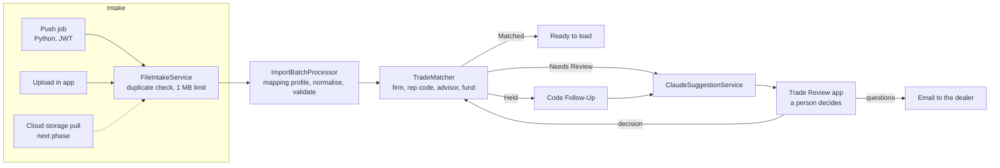

# Trade View

**Dealer trade file reconciliation for wealth management, built natively on Salesforce with Claude.**

Wealth management firms receive trade, AUM and advisor-roster files from the dealers they work with. Each dealer sends
its own layout, spells firm and fund names its own way, and uses rep codes that change hands without notice. Operations
teams spend hours matching every row to the right firm, advisor and fund before anything can be reported or paid.

Trade View does that matching automatically. Rules settle what they can, Claude suggests answers for the rest, and a
person makes every final decision in one review app. All data in this repository is synthetic: every firm, advisor and
fund is fictional.

<!-- Screenshots: add images to docs/images/ and uncomment.


-->

## What it does

- **Takes files in from three routes:** a push job, a file upload in the app, and (next) a pull from cloud storage.
  Every route goes through one intake service, which rejects duplicates by checksum and enforces a 1 MB limit.
- **Reads any dealer's layout.** A mapping profile per file format turns columns into fields. When a new format
  arrives, Claude proposes a mapping and a person activates it.
- **Matches every row** to its firm, rep code, the advisor(s) holding that code on the trade date (including team
  splits), and the fund. Each row ends up Matched, Needs Review, Held (behind a rep code problem) or Invalid.
- **Asks Claude about what rules can't settle.** Claude answers per field, with a confidence and a reason, plus a
  one-line root cause and a recommended action: accept, reject, or hold for the dealer.
- **Puts a person in charge of every decision** in the Trade Review app:
  - **Dealer Code Review:** rep codes to fix, the trades held behind them, and roster changes. Each roster change
    shows exactly what approving it will create or end.
  - **Needs Decision:** firm, fund and other data questions. Rows with the same problem (the same misspelt fund from
    the same dealer, say) show as one line with their row count and total, and one decision settles them all.
  - **On Hold:** items only the dealer can answer.
  - **Email Firms:** one email per dealer covering all of its open questions. Claude drafts it, it never includes
    amounts, and a person sends it from Salesforce's standard email window, so it's logged on the dealer's account.
  - **New File Format** and **Recent Files.**
- **Learns as it goes.** Remembered spellings become aliases, so tomorrow's file matches on its own. Matching rules
  are written in plain language, and activating one can require a second person's approval (on by default).

## How it works



**Claude is a suggestion engine, never the decision maker.**

- **No record IDs:** Claude sees short keys (R1, F1, P1) instead of Salesforce IDs.
- **Strict checks on every answer:**
  - unknown items or fields, duplicates, values outside the choices offered, and accept-without-the-needed-answer are
    all rejected;
  - text is length-capped;
  - keys are translated back to record names before anything is stored.
- **A tested copy of the rules:** the same checks are mirrored in a Python port, and shared test vectors generate
  the Apex tests, so both always agree.
- **Logged in full:** every call is recorded with its prompt, response, model, provider, duration and token counts.

## Two tiers

| | Enterprise (default) | Standard |
|---|---|---|
| Route | Salesforce Models API through the Einstein Trust Layer | Anthropic Messages API with the firm's own key |
| Model | Claude through `sfdc_ai__DefaultBedrockAnthropicClaude5Sonnet` | `claude-sonnet-5-5` |
| For | Firms with Einstein generative AI licences and strict compliance mandates | Smaller firms without those licences |
| Key storage | n/a | External Credential (never in code or metadata) |
| Cost control | Token logging | Token logging plus prompt caching of the instructions |

Switching tiers is one custom metadata setting. No Apex depends on the Standard-tier credentials at compile time, so
an Enterprise install can leave them out entirely.

## Data model

| Object | Holds |
|---|---|
| Import Batch | One received file: dealer, checksum, mapping profile, status and row counts |
| Import Staging Row | One row of a file: source values, match results, Claude's answer, the reviewer's decision, hold and issue grouping |
| Mapping Profile | How a dealer's columns map to fields, recognised by a header fingerprint |
| Rep Code, Rep Code Assignment | Who holds each code at each firm, from when, and at what share |
| Firm Alias, Fund Alias | Known spellings of firms and funds |
| Code Follow-Up | A rep code problem with the trades held behind it |
| Matching Rule | A plain-language convention Claude follows, approved by a second person |
| AI Request Log | Every Claude call, with tokens and outcome |
| Trade, Trade Allocation | The loaded result (next phase) |

Firms and branches are Accounts, advisors are Contacts, and funds are Products.

## Quality

- **151 Apex tests** in 22 test classes. One test runs every reviewer action as a Standard User holding only the
  Reviewer permission set, to prove the permissions are complete.
- **50 LWC Jest tests** across the three components.
- **Python ports with shared test vectors** for CSV parsing, normalisation, name matching and Claude-answer validation.
- **Checks before every deploy:**
  - Apex parse;
  - PMD security, performance and error-prone rules (zero findings);
  - a custom lint for platform pitfalls the local parser misses, such as reserved words used as names, and ORDER BY
    with FOR UPDATE;
  - field cross-references between code and metadata;
  - LWC-to-Apex parameter and schema checks.

  Each check is proven with a negative control: break the code on purpose and confirm the check fails.
- **Security:** every query and update runs in user mode, with least-privilege permission sets for the integration
  user, reviewers and admins.

## Repository layout

| Path | Contents |
|---|---|
| `force-app/main/default/` | Apex classes and triggers, LWCs (`tradeReview`, `reviewQueueTable`, `aiSuggestionTable`), objects, layouts, permission sets, credentials |
| `pushjob/` | Python push job (Salesforce CLI or JWT bearer authentication) and its tests |
| `datalake/samples/` | Sample dealer files with every planted problem |
| `data/` | Seed data: firms, branches, advisors, funds, rep codes, aliases |
| `scripts/` | Demo reset scripts and Apex scripts |
| `tools/gen/` | Generators for the metadata, seed data and build log |
| `tools/verify/` | Lint, cross-reference checks, Python ports and test-vector generators |
| `PHASE*.md` | Step-by-step run guide for each build phase |

## Try it

You'll need a Salesforce Developer Edition org, the [Salesforce CLI](https://developer.salesforce.com/tools/salesforcecli),
and Python 3 for the push job.

```powershell
sf org login web --alias tradeDemo
sf project deploy start --source-dir force-app --target-org tradeDemo
sf org assign permset --name Trade_Import_Admin --target-org tradeDemo
sf data import tree --plan data/seed-plan.json --target-org tradeDemo
sf apex run --file scripts/apex/seed-mapping-profiles.apex --target-org tradeDemo
```

Then set up the push job's environment as in `PHASE2.md` and run the full demo:

```powershell
.\scripts\reset-demo-full.ps1
```

Open **Trade Review** from the App Launcher. To have Claude make suggestions, turn on Einstein generative AI
(Enterprise tier), or follow `PHASE4A.md` to use an Anthropic API key (Standard tier). Without either, matching and
review still work, just without suggestions.

## Roadmap

- **Cloud storage pull:** S3, Azure Blob and Google Cloud Storage.
- **Setup Assistant:** a guided first-time configuration covering all three intake routes.
- **Loading approved rows** into Trade, Trade Allocation and AUM records.
- **Holder confirmation** for dormant codes, and notifications instead of polling.
- **One Claude call per shared issue** instead of per row, to cut cost on large files.

## Author

Greg Baronian, Salesforce consultant.
